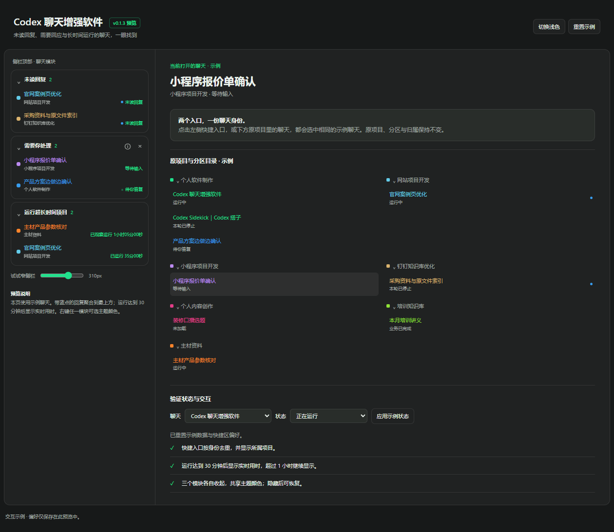
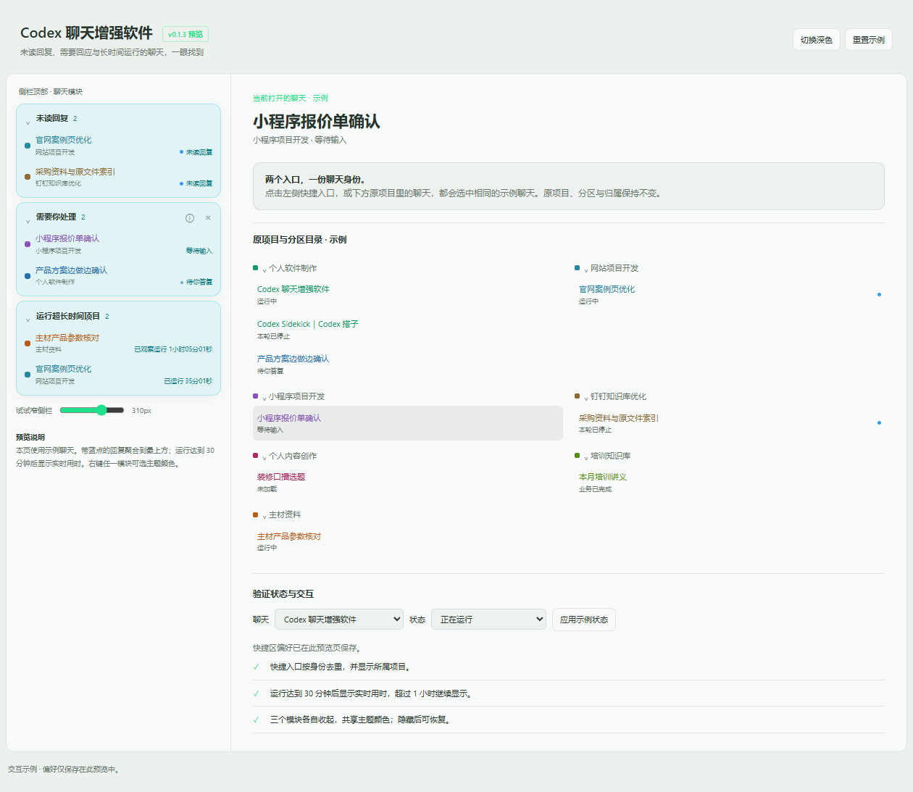
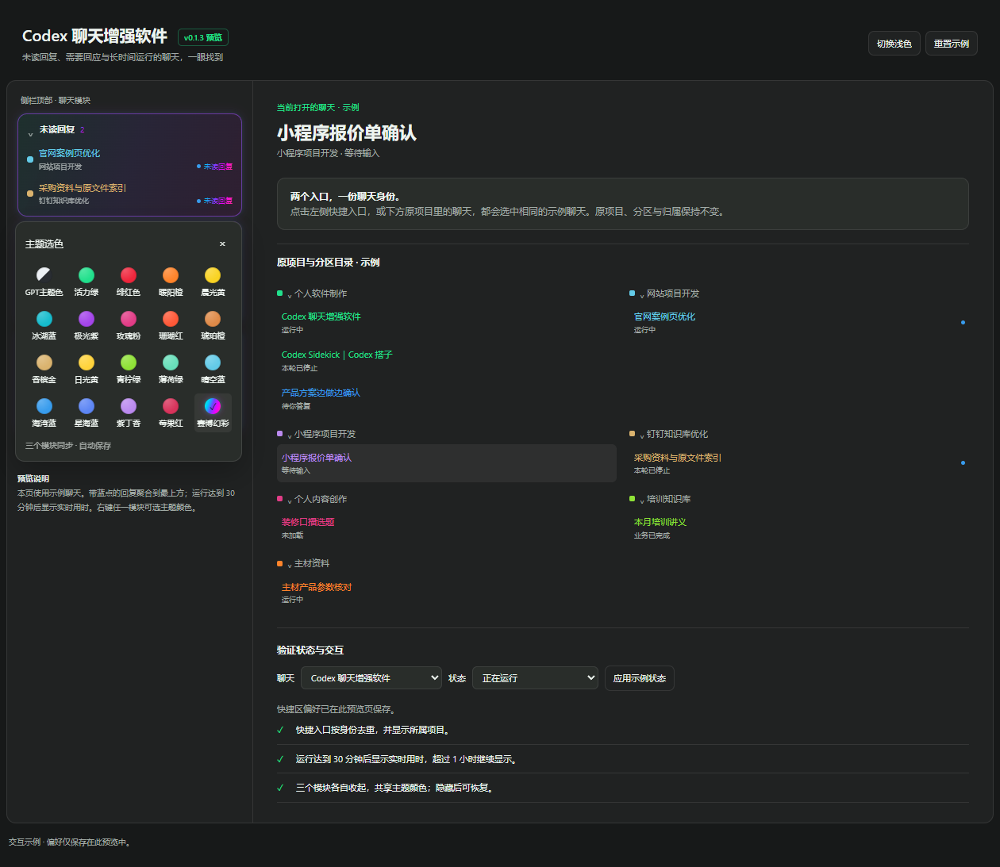

# Codex Chat Enhancer｜Codex 聊天增强软件
### Stop waiting for a reply that is already there.

[English](README.md) · [简体中文](README.zh-CN.md)

Running several Codex chats? A reply can arrive while its blue dot is buried in a collapsed project. Questions wait in another chat, and a long-running task gives you no easy sense of elapsed time.

**Bring unread replies, things that need you, and long-running chats to the top of the sidebar.** Open the original chat with one click.

**[Download v0.1.3 for Windows](https://github.com/KandyTiao/codex-chat-enhancer/releases/download/v0.1.3/codex-chat-enhancer-v0.1.3.zip)** · [Setup guide](docs/INSTALL.md) · [Release notes](https://github.com/KandyTiao/codex-chat-enhancer/releases/tag/v0.1.3)

> **Windows development preview.** Tested with Codex 26.1002.7124. Requires Node.js 24+ and an existing local Codex debug connection. The interface is in Chinese. macOS compatibility is unverified. A community tool, not an official OpenAI plugin.

*The real preview interface, using fictional sample chats. The left-hand cards illustrate the sidebar additions; this is not a private Codex conversation screenshot.*

## Less searching. A clearer next step.

| When this happens | What you get |
| --- | --- |
| A blue dot is buried in another project | **Unread replies** together at the top, including collapsed projects |
| Codex is waiting for an answer or approval | **Needs your attention** for questions, approvals and errors |
| A chat has been running for a long time | **Long-running chats** from 30 minutes onward, with a live elapsed time |

Unread means the official Codex blue-dot state, independently of whether a task is running. Opening the same original chat lets Codex report its read state; this tool does not bulk-mark chats as read.

The timer resets with a new turn. If its actual start is unavailable, it says **observed running**. A long duration is a cue to inspect the chat; it does not prove the task is stuck and does not automatically restart it.

## Your sidebar, your theme

Right-click a card to choose from 20 themes, including GPT, classic green and a multicolor theme. Collapse the three cards separately, or hide and restore them together. Existing chat/project locations remain intact. Works alongside [Codex Sidekick｜Codex 搭子](https://github.com/KandyTiao/codex-sidekick-downloads).

<strong>See light mode and theme selection</strong>

## Start in three steps

1. Have **Node.js 24+**, official Codex for Windows and a working **localhost debug connection** (default port 39222). If you only want to try the UI, the guide includes a sample-only mode.
2. Download and extract the ZIP to a writable folder. Run **启动开发预览.cmd**.
3. Open a Codex window with its sidebar visible. Check the guide to confirm native connection; opening the sample webpage alone does not confirm it.

To stop this tool, run **停止开发预览.cmd**. It does not install a system-wide service or enable sign-in startup. This package is Node.js scripts, not a standalone EXE installer. [Full instructions and troubleshooting](docs/INSTALL.md).

## Local and focused

No extra model requests or author-operated server. This tool reads local sidebar identity/status information and stores its own preferences locally. It does not copy chat bodies or login credentials. Official Codex updates can change the internal interfaces it depends on. Windows testing covered 88 unit checks, 65 preview checks and 17 native checks; remote/ChatGPT behavior and macOS remain incompletely validated.

**Free to download and use. Program modification and redistribution are not permitted.** [Usage license](LICENSE). Development source is maintained privately; this public repository provides the guide, screenshots and downloads.
